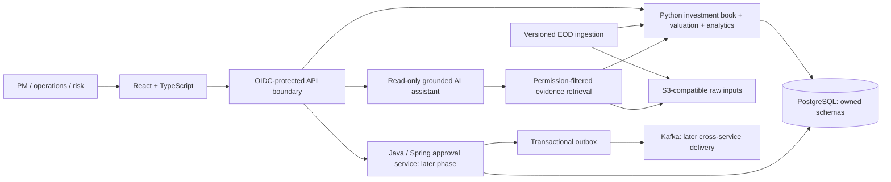

# Target architecture and boundaries

[繁中閱讀摘要](../zh-TW/architecture.md) — selected concepts; the complete English specification remains authoritative.

Status: incremental target design, not the currently deployed system. [ADR-008](adr-008-investment-operations.md) owns the strategy and alternatives. [Domain rules](../domain/investment-operations.md) own business behavior.

## Current baseline and first slice

Existing API routes, authentication, market-data models and React UI remain in place. SQLAlchemy `create_all` and multiple SQL initialization scripts exist; no authoritative versioned migration chain has been established. Legacy operational routes and dashboards include mock values. The bounded Ollama agent is isolated from these services.

The new `portfolio` Python package is a pure domain boundary with no FastAPI, ORM, vendor, or model imports. An offline synthetic CLI calls it. It is intentionally not exposed as a multi-tenant API before portfolio authorization and persistence contracts exist.

## Target logical view

Every box beyond the existing baseline and pure valuation module is a target. Shared PostgreSQL infrastructure does not permit cross-service table writes. A single modular process is acceptable until a service extraction has an implemented use case and failure tests.

## Module ownership and dependency direction

| Boundary | Owns | Allowed dependencies / constraints |
|---|---|---|
| Portfolio domain | Snapshot value rules and quality outcomes | Standard-library types; no framework, persistence or model dependency |
| Ingestion adapters | Vendor normalization, freshness and raw source versions | Calls domain/application interfaces; cannot bypass validation to publish positions |
| Book / analytics application | Position reconstruction, valuation snapshots, reconciliation, risk/performance | Domain + repository ports; deterministic calculations stay outside LLM |
| Order / approval service | Proposal versions, transitions, mandate evidence and audit/outbox | Versioned snapshot API/events; cannot write book tables |
| AI adapter | Summaries, retrieval orchestration and model protocol | Read-only, portfolio-filtered tools; no order mutation or arbitrary URL/shell |
| UI | User workflow, provenance and exception display | Typed HTTP contracts; no authoritative risk or approval checks in browser |

Existing legacy imports do not yet satisfy these boundaries. Enforce the new portfolio package's independence in the context verifier; migrate other modules only with appropriate tests and adapters.

## Stack decisions and entry gates

| Technology | Role / rationale | Adoption state and gate |
|---|---|---|
| Python 3.12 / FastAPI / SQLAlchemy | Preserve existing investment-data and AI foundation | Existing. New DB work first needs versioned migrations and transaction tests. |
| PostgreSQL | Transactional positions, evidence references, approval/audit consistency | Existing local PostgreSQL 15. Version bump is separate from renaming; use supported minor updates and test restore/migrations. |
| React / TypeScript / Vite | PM and operations workflow | Existing versions live in package/lock files. New UI requires typed API, auth and explicit quality states. |
| Java 21 / Spring Boot | Typed transactional order/approval boundary; relevant JVM experience | Proposed phase 3. Pin a supported Spring/JDK pair at implementation; build the workflow before extracting a service. |
| Kafka + transactional outbox | Cross-service event delivery and replay | Proposed only when two real consumers/services need it. At-least-once delivery with idempotent consumer inbox; no end-to-end exactly-once claim. |
| Redis | Optional bounded cache or distributed rate limit | Not an authoritative ledger. Add only with invalidation/failure policy and measured need. |
| S3-compatible storage / Parquet | Immutable input evidence and analytical export | Existing MinIO configuration is historical; implement versioned objects/checksums and retention before use. |
| Airflow | Scheduled EOD ingest/reconciliation dependencies | Existing legacy DAGs. Retain only for an implemented schedule with retries, deduplication and backfill tests. |
| Ollama + provider adapter | Local reproducible bounded AI; optional hosted model | Existing synthetic PoC. Portfolio integration gated by access filters and evaluation. MLflow only when a trained model requires a lifecycle. |
| Docker Compose / GitHub Actions | Reproducible local stack and release checks | Existing. New context/domain CI is dependency-free; full stack checks remain separate. |
| AWS / Terraform | Proposed deployable target: managed DB, object storage, identity and container runtime | Design proposal. Select region, budget, data handling and recovery target first. Legacy OCI/k3s is not silently redeployed. |
| Kubernetes / Helm | Later deployment and operating exercise | Optional after working workflow, observability, restore and cost evidence. Managed containers are a valid simpler alternative. |
| OpenTelemetry / Prometheus / Grafana | Traces, service metrics and operational dashboards | Target integration. Existing monitoring config does not prove end-to-end observability. |

This is a staged engineering curriculum, not a dependency installation checklist. Current version authorities are the manifests and lockfiles, not a prose version table. Official compatibility references: [Spring requirements](https://docs.spring.io/spring-boot/system-requirements.html), [PostgreSQL support](https://www.postgresql.org/support/versioning/), [Kafka delivery semantics](https://kafka.apache.org/41/design/design/).

## Required enterprise properties

- **Contracts:** code-first FastAPI OpenAPI; a future Java contract has one generator/source, compatibility checks and additive versioning. Decimal financial values use strings with currency/unit metadata. Idempotency keys bind a request hash; conflicting reuse returns a conflict.
- **Data:** migration chain and schema ownership, UTC timezone-aware system timestamps plus business dates, reproducible as-of snapshots, unique constraints and transaction boundaries. A correction never rewrites published evidence invisibly.
- **Security:** OIDC identity, role plus portfolio authorization, independent approver, least privilege service accounts, secrets outside Git, parameterized queries and redacted logs. Existing JWT is a baseline, not proof of OIDC or tenant isolation.
- **Consistency:** approval, audit and outbox insert commit atomically in the owning service. Consumer deduplication and ordering are per aggregate/version. Dead-letter handling, replay authorization and reconciliation are required before messaging is released.
- **Reliability:** observable queue lag, freshness, blocked valuations and reconciliation breaks. Bound retries with backoff; distinguish business rejection from transient failure. Missing financial evidence fails closed.
- **Delivery:** build immutable images, record provenance and vulnerability findings, run migrations with compatibility/rollback planning, and require environment approval for cloud changes. New image namespace `ghcr.io/chuliyu/alphapulse/*` requires fresh publishing; old packages are not automatically renamed.

The release evidence and unmeasured service objectives are defined in [operations](../engineering/operations.md) and [testing](../TESTING.md).
